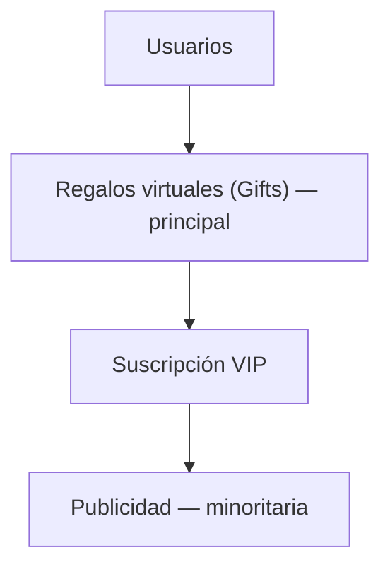

---
tags:
  - producto
  - grasp
  - monetizacion
---

# Modelo de negocio

> [!warning] Estado al 2026-10-13: los pagos están pospuestos
> Por el [[0042-pagos-y-vip-se-posponen-hasta-validar|ADR 0042]], gifts (Fase 8), cobro de VIP (9b) e
> interstitial van **después de validar la app**. Hoy existen: el **VIP sin cobro** (9a, dado a mano con
> un comando) y el **saldo diario de voz** de 30 min, ampliable con **anuncios con recompensa** cuyos
> minutos concede el servidor tras verificar la firma SSV de AdMob ([[0041-tope-diario-de-minutos-en-salas|ADR 0041]]).
> Lo de abajo es el diseño de destino, no lo desplegado.

Tres niveles, en orden de prioridad de ingresos — la publicidad es deliberadamente la fuente
**minoritaria**:

## Gifts (regalos virtuales)

- Fuente **principal** de ingresos. Durante una sala de voz, cualquier usuario puede enviar un regalo a
  un participante del escenario como reconocimiento voluntario — **no** es pago por servicios.
- Mecánica: el usuario compra monedas vía IAP (Apple/Google) → las usa para enviar un gift → la
  plataforma retiene una **comisión** → el anfitrión recibe saldo virtual.
- Catálogo de ejemplo: ☕ Café, ❤️ Corazón, 🌟 Estrella, 🎉 Aplauso, 🌈 Grasp, 🏆 Mentor.
- Antifraude: importe mínimo para retirar, validación de identidad, revisión manual de cuentas
  sospechosas, límites de retirada, **detección de regalos circulares** entre cuentas.
- Invariante contable (comisión de plataforma, imposibilidad de ganar monedas de la nada): ver
  [[Gifts-y-pagos]] (skill `gifts-ledger`).
- Estado real: Edge Function `gift-send` — **pendiente** (solo `README.md`, Fase 8). Tabla
  `coin_wallets`/`gift_transactions` — especificadas, no aplicadas.

## Suscripción VIP

- Objetivo: mejorar la experiencia sin costes de infraestructura desproporcionados. **No** es un modelo
  de salas ilimitadas — una suscripción de bajo coste no puede sostener consumo ilimitado de audio en
  tiempo real.
- Beneficios: crear una sala diaria (máx. 2h), prioridad para subir al escenario, perfil destacado,
  insignia VIP, llamadas privadas ilimitadas, sin publicidad, estadísticas avanzadas.
- El límite de "una sala diaria" es deliberado: evita abuso, mantiene costes previsibles, incentiva
  calidad sobre cantidad.
- Verificación de compra: **siempre server-side**, vía webhook de RevenueCat (`iap-webhook`) — nunca se
  confía en el cliente para acreditar monedas o VIP (invariante de `.claude/CLAUDE.md` §
  Backend y reglas de negocio).
- Estado real: `iap-webhook` — **pendiente** (Fase 8/9). Tabla `subscriptions` — especificada, no
  aplicada.

## Publicidad

- Un único interstitial al abrir la app, **una sola vez por sesión**.
- **Nunca** durante llamadas, salas o chats activos — regla explícita de `.claude/CLAUDE.md`.
- Futuro (fuera del MVP): anuncios nativos, patrocinio de eventos, categorías patrocinadas.

## Por qué este orden importa para el diseño

Cualquier feature nueva se evalúa por: coste de desarrollo, coste operativo, impacto en retención,
capacidad de monetización. Una feature que aumente costes sin mejorar esas métricas no entra en el MVP.
El tope del escenario (anfitrión + 2 hablantes, [[0035-escenario-anfitrion-mas-dos-hablantes|ADR 0035]]),
el aforo de 8 personas, la destrucción automática de salas vacías/sin actividad, el saldo diario de voz y
el límite diario de llamada gratuita existen precisamente para mantener bajo el coste variable (audio en tiempo
real) mientras el negocio todavía no genera para cubrirlo.

## Ver también

- [[Que-es-Grasp]]
- [[Roadmap-de-fases]]
- [[Gifts-y-pagos]]
