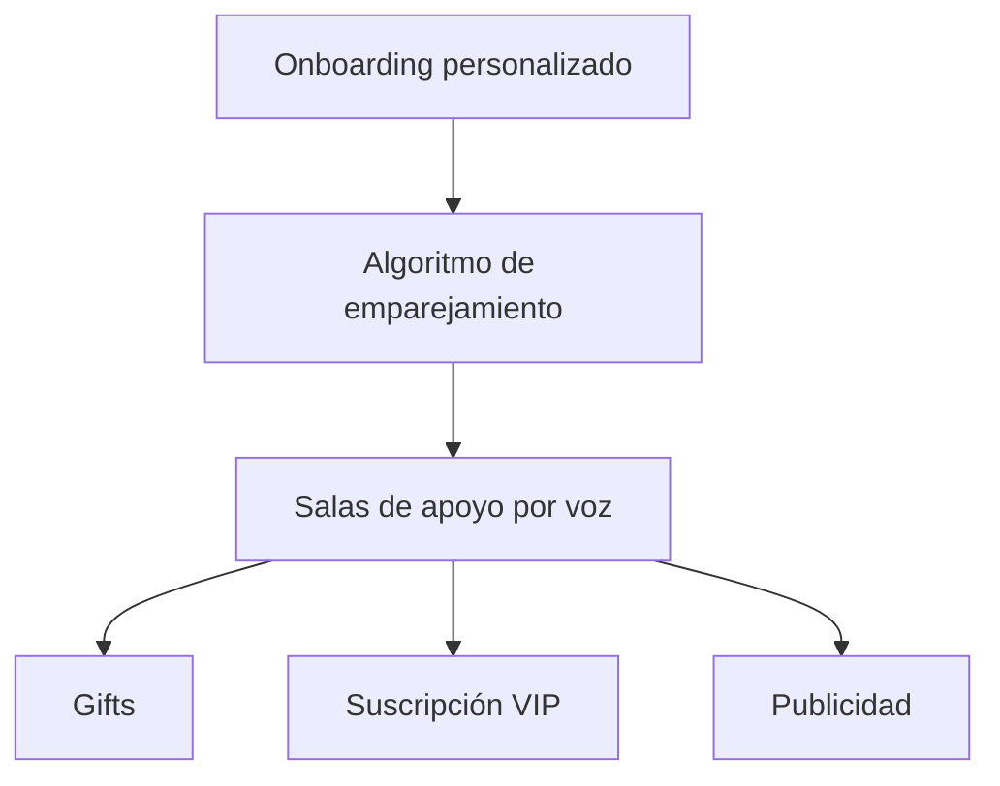

---
tags:
  - producto
  - grasp
aliases:
  - Grasp
---

# Qué es Grasp

Grasp es una app móvil (iOS/Android) de **salas de voz de apoyo entre iguales**, organizadas por categoría
de experiencia (rupturas, ansiedad, soledad, duelo, burnout, universidad…), complementada con
**mensajería directa 1:1 de texto**.

> [!important] Sin notas de voz
> La mensajería es **solo texto** — decisión explícita, no una limitación temporal. Ver
> [[0006-la-mensajeria-es-solo-texto|ADR 0006]].

## Lo que NO es

- No es una red social de contenido/publicaciones (no hay feed tipo Instagram/Twitter).
- No hay IA conversacional.
- No hay videollamada ni streaming de vídeo — todo es **voz**.
- No hay comunidades privadas ni grupos permanentes (en el MVP).

El objetivo del producto **no** es ofrecer asistencia sanitaria, terapia ni diagnóstico clínico: es
facilitar espacios seguros donde compartir experiencias y sentirse acompañado.

## Principios de producto

- **Simplicidad**: entrar en una charla en menos de 30 segundos, sin configuraciones complejas.
- **Comunidad antes que contenido**: el contenido principal son las conversaciones, no publicaciones.
- **Escalabilidad**: toda funcionalidad se evalúa por coste de desarrollo/operación vs. impacto en
  retención y monetización.
- **Seguridad**: toda interacción está protegida por moderación y reporte.

## A quién sirve

Mercado inicial: España y Latinoamérica. Personas que buscan hablar (o escuchar) sobre una situación
vital con alguien que la ha vivido, en vez de un foro de texto tradicional.

## Modelo de negocio (resumen)

Ver [[Modelo-de-negocio]] para el detalle. El diseño prevé, en orden de ingresos: **gifts**, **VIP** y
**publicidad mínima**. Desde el [[0042-pagos-y-vip-se-posponen-hasta-validar|ADR 0042]] (2026-10-11) los
pagos se posponen hasta validar la app: hasta entonces la única fuente son los **anuncios con
recompensa**, que dan minutos de voz ([[0041-tope-diario-de-minutos-en-salas|ADR 0041]]).

Edad mínima: **18 años** ([[0044-edad-minima-18|ADR 0044]]).

## Núcleo del producto

Desde el [[0032-el-feed-de-salas-no-se-personaliza|ADR 0032]] (2026-08-31) el feed de **salas** ya no se personaliza con ese algoritmo
— es una lista de salas activas por actividad reciente. El scoring de afinidad sigue vivo, pero su único
consumidor hoy es **Conectar** (sugerencia de perfiles), no las salas.

## Estado y roadmap

Ver [[Roadmap-de-fases]] para el desglose bloque a bloque y lo que está realmente desplegado hoy.

## Notas

- El producto se llamó "Abrazo" originalmente; todo el contenido histórico que use ese nombre está
  corregido a "Grasp" — nunca reintroducir el nombre viejo.
- Documento de negocio original (histórico, pre-renombrado): `docs/Grasp-Design.md`.
- Documento maestro vigente: `docs/Grasp-ClaudeCode-Bootstrap.md`.

## Ver también

- [[Roadmap-de-fases]]
- [[Modelo-de-negocio]]
- [[Vision-general]]
