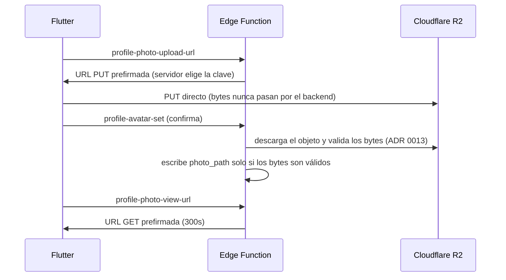

---
tags:
  - arquitectura
  - storage
  - voz
  - grasp
---

# Almacenamiento (Cloudflare R2) y voz (VoiceService)

## Cloudflare R2

Ningún fichero subido por un usuario se guarda en Postgres como bytes. Hoy eso es la foto de perfil;
el buffer del botón de pánico que se preveía para la Fase 10 se descartó ([[0043-moderacion-con-revision-humana|ADR 0043]]). La fila guarda **solo la clave del objeto**
(`profiles.photo_path`, formato `avatars/{user_id}/{uuid}.webp`), nunca la URL completa ni los bytes.

Flujo real (Bloque 3, verificado contra R2 real):



Puntos clave (detalle y precedentes en [[Ficheros-de-usuario-y-R2]]):

- **RLS protege la fila, no el fichero.** La autorización del objeto la decide la Edge Function que
  firma la URL — Postgres y R2 no se conocen entre sí.
- **Avatares predeterminados vs. foto subida**: conviven (ADR 0010). Los predeterminados son assets
  **locales** de Flutter (`assets/avatars/*.png`), nunca objetos de R2 — así una clave compartida entre
  usuarios nunca se borra para todos cuando uno solo cambia de avatar.
- **Cascada de borrado explícita**: `storage_gc_queue` (cola) → `media-gc-cron` (borra de verdad en
  R2). Sin ella, borrar la cuenta no cumple el Art. 17 RGPD — el `cascade` de Postgres no llega a R2.
- **URL prefirmada emitida y no confirmada = basura**: no está en ninguna tabla hasta que se confirma,
  así que solo la detecta `media-reconcile-cron`, que compara el bucket contra la base de datos.

## VoiceService (voz en tiempo real)

Interfaz propia `VoiceService`, pensada para que el proveedor de audio sea intercambiable sin tocar la
app:

```
VoiceService (interfaz)
  ├── LiveKit   (elegido — cuenta LiveKit Cloud creada 2026-08-31, plan Build, $0 en desarrollo)
  └── Agora     (alternativa evaluada y descartada en la reverificación del 2026-08-15)
```

Estado real (2026-10-13): **voz en producción**. La Fase 6 (salas, 2026-10-06) y la 7 (llamadas
privadas, 2026-10-07/08) se probaron con dos dispositivos reales. El cliente usa LiveKit **sin su SDK de
servidor**: `_shared/livekit.ts` firma tokens y llama a la API de salas, y `livekit-webhook` recibe los
eventos. El servidor da y quita la palabra ([[0033-voiceservice-no-decide-quien-habla|ADR 0033]]), y el
saldo diario de voz limita el coste, que LiveKit cobra **por persona conectada**
([[0041-tope-diario-de-minutos-en-salas|ADR 0041]]). Contrato y trampas verificadas: [[Voz]] y skill
`voice-service`.

## Ver también

- [[Vision-general]]
- [[Ficheros-de-usuario-y-R2]]
- [[Contratos-API]]
