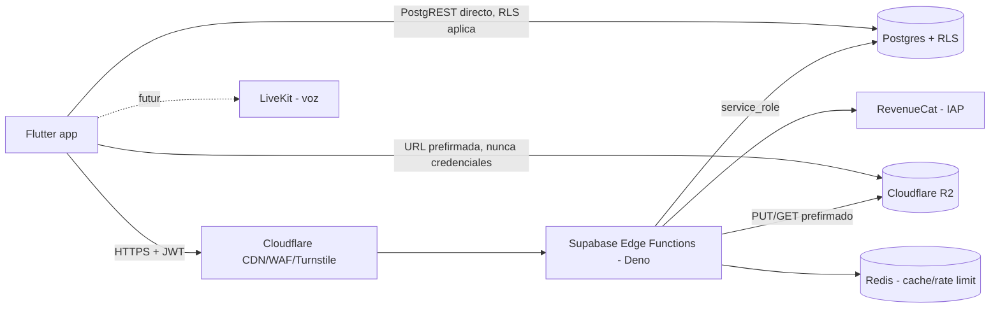

---
tags:
  - arquitectura
  - grasp
---

# Visión general de la arquitectura

Dos caminos de lectura/escritura, no uno:

1. **Cliente → PostgREST directo**, cuando la tabla tiene policies RLS y `GRANT` de columna que ya
   bastan (ej. leer `profiles`, `rooms` activas). Rápido, sin Edge Function.
2. **Cliente → Edge Function (`service_role`) → Postgres/R2**, cuando hay regla de negocio, dato
   sensible (Art. 9 RGPD), idempotencia o la tabla no tiene ningún `GRANT` para `authenticated`/`anon`
   (patrón dominante en mensajería y Conectar: `conversations` no tiene **ningún** grant de cliente).

Ver [[RLS-y-permisos]] para por qué la frontera entre los dos caminos es RLS + GRANT, no solo RLS.

## Piezas

| Pieza | Nota de detalle |
|---|---|
| Frontend móvil | [[Mobile-Flutter]] |
| Backend / Edge Functions | [[Backend-Supabase-Edge-Functions]] |
| Base de datos | [[Base-de-datos-Postgres]] |
| Contratos de API | [[Contratos-API]] |
| Ficheros de usuario y voz | [[Almacenamiento-R2-y-voz]] |

## Principio de diseño dominante

**RLS filtra filas; `GRANT` filtra columnas y verbos — hacen falta los dos.** Es el invariante más
repetido en todo el backend de Grasp (aparece en db-schema, rls-security y en casi todas las
migraciones de Fase 4/5): una tabla con policy `select` abierta pero sin `grant` para `authenticated`
es, en la práctica, una tabla cerrada al cliente — y es el patrón elegido deliberadamente para
`conversations`, `connect_*` y los contadores de `profiles`.

## Ver también

- [[Que-es-Grasp]]
- [[RLS-y-permisos]]
