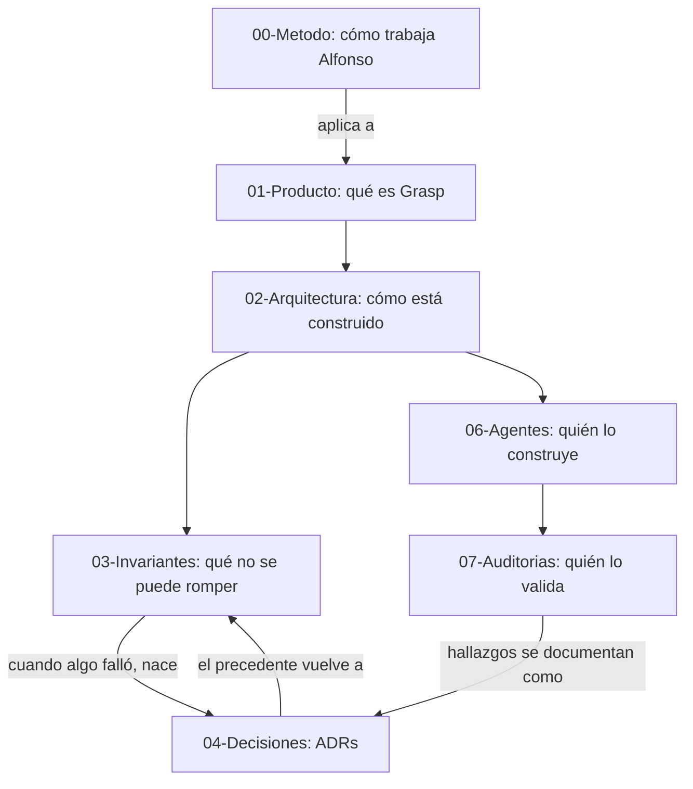

---
tags:
  - home
  - moc
  - grasp
aliases:
  - Inicio
  - MOC
---

# Grasp — Segundo cerebro

Este vault es el mapa completo del repositorio **Grasp** (app de salas de voz de apoyo entre iguales +
mensajería directa de texto). Tiene dos lectores distintos en mente:

> [!abstract] Para quién es esto
> 1. **Un futuro proyecto nuevo**, pasándole a un agente de IA generativa el *método* de trabajo de
>    Alfonso — no el código de Grasp, que no le sirve — empezar por
>    [[00-Metodo/Arrancar-un-proyecto-nuevo|Arrancar un proyecto nuevo]] y luego [[00-Metodo/Index|00-Método]].
> 2. **Claude trabajando en Grasp**, necesitando entender producto, arquitectura, invariantes y el
>    historial de decisiones sin releer 30 ficheros sueltos — empezar por las carpetas 01-07 de abajo.

## Mapa de carpetas

| Carpeta | Contenido | Nota de entrada |
|---|---|---|
| `00-Metodo/` | **La parte transferible a cualquier proyecto.** Cómo colabora Alfonso, qué principios de proceso aplicar, cómo documentar. | [[00-Metodo/Index]] |
| `01-Producto/` | Qué es Grasp, modelo de negocio, roadmap de fases y su estado real. | [[01-Producto/Que-es-Grasp]] |
| `02-Arquitectura/` | Backend (Supabase/Deno), mobile (Flutter), base de datos, contratos API, R2, voz. | [[02-Arquitectura/Vision-general]] |
| `03-Invariantes/` | Las reglas de seguridad y producto que nunca se rompen, con su precedente (qué falló y cuándo). | [[03-Invariantes/Index]] |
| `04-Decisiones/` | Las 43 decisiones de arquitectura (ADRs) del repo, una nota por decisión. | [[04-Decisiones/Index]] |
| `05-Skills-de-proceso/` | Qué skills de proceso existen (tdd, code-review, research...) y cuándo se activan. | [[05-Skills-de-proceso/Index]] |
| `06-Agentes/` | El equipo de subagentes especializados y su memoria persistente. | [[06-Agentes/Index]] |
| `07-Auditorias/` | Historial cronológico de auditorías de bloque/fase. | [[07-Auditorias/Index]] |
| — | Catálogo de reglas de negocio (`RN-xx`) de Contactos/Mensajería/Conectar. | [[Glosario]] |
| — | Referencia rápida de una página (stack, comandos, convenciones). | [[01-Referencia-Grasp]] |

## El hilo que conecta todo

Léelo como un ciclo, no como una jerarquía: una auditoría encuentra un fallo → nace un ADR → el ADR deja
precedente en la skill de invariantes correspondiente → la próxima vez que se toca ese dominio, el
precedente se lee antes de tocarlo. Ese ciclo **es** la Sección 0.2 — [[00-Metodo/Retroalimentacion-continua]].

## Las tres ideas más reutilizables (si solo lees tres notas)

> [!tip] 1. La regla y su precedente viven separados
> [[00-Metodo/Sistema-de-skills-y-precedentes]] — la regla (barata, se carga siempre) va en un fichero
> corto; el precedente (caro, solo hace falta por dominio) va en la skill. Aplica a cualquier repo con un
> CLAUDE.md o equivalente que crece sin volverse ilegible.

> [!tip] 2. Nada se da por completo sin reconstruir el entorno
> [[00-Metodo/Memoria-persistente-y-verificacion]] — una memoria, un commit o un "ya está hecho" es una
> hipótesis hasta que se verifica contra el estado actual. Vale para cualquier proyecto con infraestructura
> que cambia bajo los pies (migraciones, despliegues, tokens).

> [!tip] 3. Cuestionar antes de ejecutar
> [[00-Metodo/Principio-cuestionar-antes-de-implementar]] — no implementar en silencio algo inseguro o mal
> secuenciado solo porque "es lo que se pidió"; avisar razonadamente, y si el usuario insiste, respetarlo y
> documentar el desacuerdo.

## Convenciones de este vault

- Todo en español, igual que el repositorio.
- `[[wikilinks]]` para notas internas; enlaces Markdown estándar para ficheros fuera del vault (p. ej.
  `docs/decisions/0006-....md`).
- Cada carpeta numerada tiene su propio `Index.md` — empieza siempre por ahí, no por los ficheros sueltos.
- Las notas de `04-Decisiones/` son deliberadamente cortas (5-10 líneas): son un resumen con link al ADR
  original, no una copia.
- Este vault se corrige igual que el resto del repo: si algo caduca, se actualiza aquí en el mismo turno
  — [[00-Metodo/Retroalimentacion-continua]].

---

*Vault construido el 2026-10-04 y puesto al día el 2026-10-13 (ADRs 0033–0044, Fases 5–10a, invariantes
nuevos), con los principios de [[00-Metodo/Como-trabaja-Alfonso]]. Punto de entrada único: esta nota.*

> [!warning] Este vault es un resumen, no la fuente de verdad
> Si algo de aquí contradice a `.claude/CLAUDE.md`, a una skill o a `docs/`, manda el repositorio y esta
> nota está caducada: se corrige en el mismo turno. Para comprobar si el vault va por detrás, compara el
> último ADR de `docs/decisions/` con el último de [[04-Decisiones/Index]].
